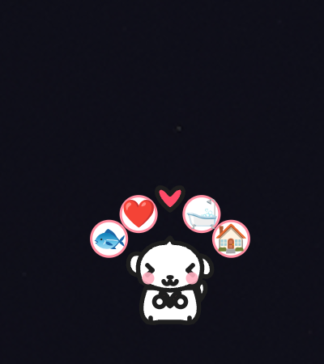
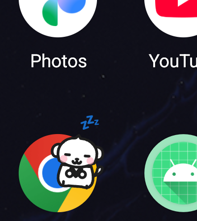
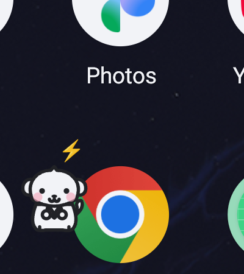
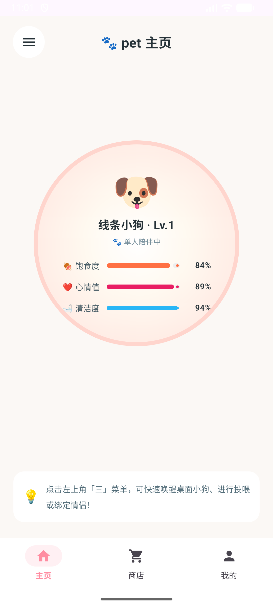
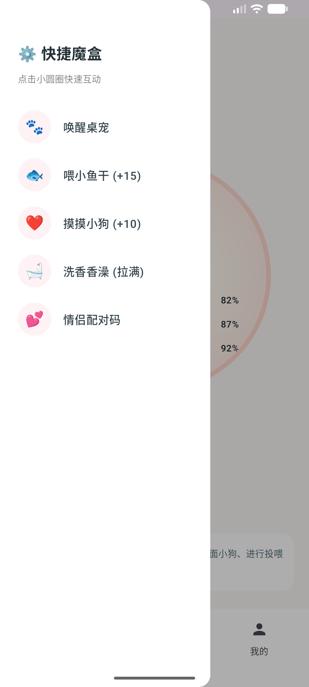
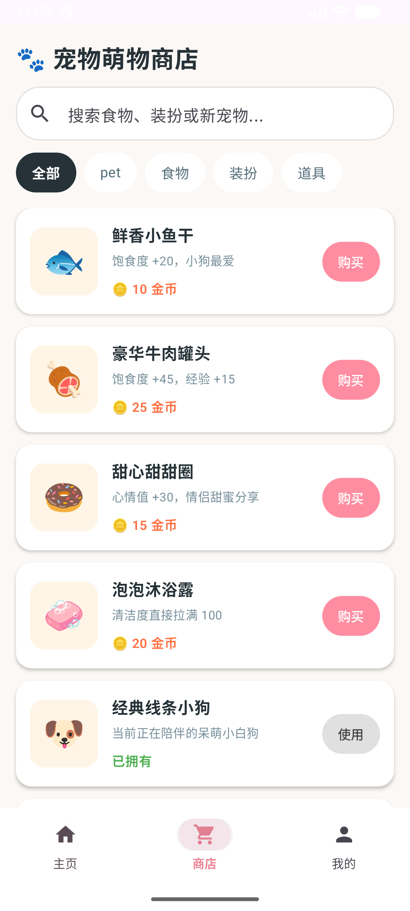

# 🐾 Pet | 2D 治愈系线条小狗桌面伴侣宠物 (Android)

<div align="center">


<br/>

**专为情侣与陪伴设计的高品质 2D 极简手绘“线条小狗”桌面宠物**  
全局悬浮置顶 · 自主漫步巡游 · 桌面径向气泡微交互 · 系统电量状态实时感知 · 伴侣专属小屋

</div>

---

## 📸 运行预览 (Live Showcase)

| 桌面即时气泡菜单 | 低电量困倦感知 (zZZ) | 充电闪电动效 (⚡) |
| :---: | :---: | :---: |
|  |  |  |
| 单击小狗弹出 4 弧形粉白气泡 | 电量低于 20% 双眼下垂困倦 | 接入电源闪烁黄色小闪电 |

| 伴侣 App 主页大圆盘 | 手绘快捷魔盒抽屉 | 宠物商店列表 |
| :---: | :---: | :---: |
|  |  |  |
| 实时状态圆盘与三维属性条 | 严谨复刻纸上原型 5 快捷圆圈 | 搜索框、分类 Chip 与萌趣商品 |

---

## ✨ 核心特性

### 1. 🐕 2D 极简手绘线条小狗物理引擎
- **手绘马克笔质感**：纯白蓬松狗毛、黑色平滑圆润轮廓笔触、腮红粉晕。
- **细腻生命动效**：待机温顺呼吸微动、开怀摆动小尾巴、点击闭眼害羞微笑 (`^ ^` / `> <`)。
- **真实重力与弹性力学**：手指抓取挣扎受困、松手自适应重力坠落平稳触底、触底瞬间呈现物理挤压与回弹（Squash & Stretch）。

### 2. 🎈 桌面即时径向气泡菜单 (Radial Quick Menu)
- 单击桌面小狗即以弹性物理抛物线展开 4 个弧形操作气泡：
  - 🐟 **投喂小鱼干**：加 15 饱食度，小狗开怀弹跳。
  - ❤️ **摸摸小狗**：加 10 心情值，冒出跳跃红心。
  - 🛁 **洗香香澡**：干爽清洁度瞬间拉满。
  - 🏠 **返回小屋**：一键无缝唤起伴侣应用主界面。
- 拖拽小狗或点击屏幕空白区域自动平滑收起。

### 3. 🐾 桌面自主漫步与智能避障 (Autonomous Roaming)
- 闲置静止约 3 秒后，自动触发可爱踱步状态机。
- 沿手机屏幕底部左右慢悠悠漫步，附带左右晃脑与摇尾节奏。
- **自适应边界碰撞检测**：碰触屏幕左/右边缘自动转身折返，绝不移出屏幕可视区。

### 4. 🔋 系统电量与充电状态感知 (System Perception)
- 深度集成 Android `ACTION_BATTERY_CHANGED` 系统广播：
  - **低电量提醒 (< 20%)**：小狗呈瞌睡眼，头顶悬浮 `💤` 气泡，提示主人为手机补电。
  - **充电动效感知**：接入充电器时，小狗耳朵旁激活动态金色小闪电 `⚡`。

### 5. 🏡 严格复刻纸上原型的伴侣 App
- **主页 (Home)**：居中状态大圆盘，动态呈现饱食、心情、干爽 3 围数值进度条。
- **抽屉快捷魔盒 (Drawer)**：左上角汉堡键滑出 5 个独立小圆圈快捷键（唤醒/收起桌宠、喂食、抚摸、洗澡、配对码）。
- **商店 (Shop)**：顶部搜索栏 + 4 种分类胶囊 Chip（零食、玩具、清洁、装扮）+ 瀑布流商品卡片。
- **我的 (Profile)**：按设计规划保持纯净占位留白，预备下一阶段定制。

---

## 🛠️ 技术架构与工程实现

```text
com.couple.pet
├── MainActivity.kt                 # 伴侣 App 入口与全局 Compose 导航控制
├── service/
│   └── PetFloatingService.kt       # 前台常驻保活服务 (WindowManager + 电池广播监听)
├── view/
│   └── PetFloatingView.kt          # 自定义桌面悬浮画布 (手绘物理/自主漫步/气泡菜单)
├── ui/
│   ├── HomeScreen.kt               # 主页大圆盘看板与快捷抽屉
│   ├── ShopScreen.kt               # 宠物商店与分类列表
│   └── ProfileScreen.kt            # 个人主页占位留白
├── model/
│   └── PetMotionState.kt           # 动作状态机 (IDLE, WALKING, DRAGGED, FALLING)
└── network/
    └── PetSyncEngine.kt            # 双人情侣双向同步引擎预留接口
```

---

## 🌲 Git 工业级工程协作规范

本项目严格对齐 `dianchu-demo` 工业级多分支管理规范与 `--no-ff` 拓扑流：
- **`master`**：生产环境稳定发布基线。
- **`dev`**：核心集成分支与持续开发主干。
- **`mvp/pet/feat/<feature>/<YYMMDD>`**：短期独立特性分支，开发完成后通过 `--no-ff` 合并回 `dev`，在 Git Graph 中呈现出彩色的清晰分叉拓扑树。

详细规范参见文档：👉 [docs/GIT_WORKFLOW.md](docs/GIT_WORKFLOW.md)

---

## 🚀 快速构建与运行

### 运行环境要求
- **Android Studio**：Ladybug (2024.2+) 或更高版本
- **JDK**：17+
- **Android 目标版本**：Target SDK 35 (Android 15), Min SDK 26 (Android 8.0)
- **设备**：开启「显示在其他应用的上层」（悬浮窗权限）

### 命令行编译与安装
```bash
# 1. 克隆代码仓库
git clone -b dev https://github.com/make669/pet.git
cd pet

# 2. 编译并安装至连接的设备或模拟器
./gradlew installDebug

# 3. 授权悬浮窗权限 (也可在系统弹窗手动开启)
adb shell appops set com.couple.pet SYSTEM_ALERT_WINDOW allow

# 4. 启动应用
adb shell am start -n com.couple.pet/.MainActivity
```

---

<div align="center">
Made with ❤️ by make669 & Antigravity
</div>
